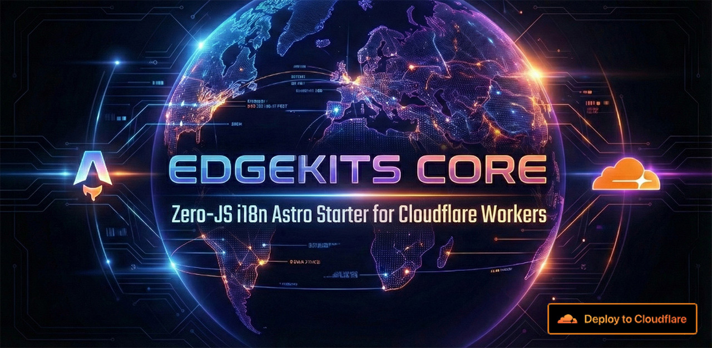

# Astro EdgeKits Core: Zero-JS i18n Astro Starter for Cloudflare Workers

<div align="center">
<a href="https://deploy.workers.cloudflare.com/?url=https://github.com/EdgeKits/astro-edgekits-core"></a>
</div>

**Astro + Cloudflare Workers + KV + Type-Safe i18n**

> [!IMPORTANT] **Building a commercial SaaS or Telegram App?**
>
> This repository is the open-source **starter**; its i18n engine, `@edgekits/astro-i18n`, is MIT too.
> If you need a production-ready foundation with **Authentication**, **Multi-tenancy (Orgs/Teams)**, **D1 Database**, and **Billing (Stripe/Paddle)**, check out the Pro kits.
>
> 🚀 **[Join the EdgeKits Waitlist](https://edgekits.dev)** to get the Early Bird launch discount.

---

## What this is

A multilingual Astro site on Cloudflare Workers, built on the npm package
[`@edgekits/astro-i18n`](https://www.npmjs.com/package/@edgekits/astro-i18n) and set up with its
`astro-i18n` agent skill. The package is the engine; this repository is a small site that uses it.

i18n here is data on the edge, not code in the bundle. Translations live in Workers KV, one JSON
value per locale and namespace; the server fetches only the namespaces a page renders, caches each
one at the edge, and sends plain HTML. Your Worker weighs the same with 2 languages or 50, and
changing a string is a KV write, not a redeploy.

The demo, in five locales (`en`, `de`, `es`, `ja`, `pt-br`):

- **Landing page** with copy from KV and typed keys (`landing.hero.title` is checked by TypeScript).
- **Blog** on an Astro content collection. One post exists only in English and German, on purpose:
  the list shows every post in every locale and flags the untranslated ones; open that post in
  Spanish, Japanese or Portuguese and you get the English post with a missing-translation banner
  and a canonical pointing at the English URL.
- **Newsletter form** over an Astro Action: errors travel as codes and are localized from the
  `messages` namespace, the browser gets no zod and no framework, and the form also works with
  JavaScript turned off.
- **Multilingual SEO**: `<html lang>`, hreflang with `x-default`, a sitemap with alternates, one RSS
  feed per locale, `llms.txt` and `robots.txt`.
- **Language switcher** with flags, and a locale-routing middleware that redirects `/` by cookie,
  then `Accept-Language`, then the default locale.

No React, no hydration directives: the only client JavaScript is the switcher's custom element and
the form controller.

> 📖 **Deep dive:** the architecture and the decisions behind it.
>
> - **[Edge-Native i18n - Part 1: Zero-JS Architecture](https://edgekits.dev/en/blog/edge-native-i18n-astro-cloudflare-part-1/)**
> - **[Edge-Native i18n - Part 2: Localizing Forms on the Edge](https://edgekits.dev/en/blog/edge-native-i18n-astro-cloudflare-part-2/)**
> - **[Edge-Native i18n - Part 3: Granular Edge Cache Purging](https://edgekits.dev/en/blog/granular-edge-cache-purge-astro-cloudflare-part-3/)**

## Branches

| Branch                   | What it is                                                                                    |
| ------------------------ | --------------------------------------------------------------------------------------------- |
| `main`                   | This starter: zero-JS, on `@edgekits/astro-i18n`.                                             |
| `react-islands`          | Coming: `main` plus React islands and a react-hook-form variant of the newsletter form.       |
| `v1-version-based-cache` | Archive: the hand-copied engine with version-based cache keys, as described in Parts 1 and 2. |
| `v2-purging-cache`       | Archive: the hand-copied engine with granular cache purging, as described in Part 3.          |

The archives are frozen. New work happens on `main`, and the engine itself evolves in the package.

---

## ⚖️ Core vs. EdgeKits Pro

Astro EdgeKits Core is the best possible _starting point_ for i18n projects. The Pro Starters are fully integrated products designed to save 100+ hours of setup.

| Feature                   | `astro-edgekits-core` | [SaaS Starter](https://edgekits.dev) | [TMA Starter](https://edgekits.dev) |
| :------------------------ | :-------------------: | :----------------------------------: | :---------------------------------: |
| **License**               |      MIT (Free)       |              Commercial              |             Commercial              |
| **i18n Engine (Zero-JS)** |          ✅           |                  ✅                  |                 ✅                  |
| **Edge Caching**          |          ✅           |                  ✅                  |                 ✅                  |
| **Authentication**        |       ❌ (DIY)        |       ✅ (Email/Pass + Social)       |         ✅ (Telegram Auth)          |
| **Database**              |        KV Only        |        ✅ Cloudflare D1 (SQL)        |       ✅ Cloudflare D1 (SQL)        |
| **Multi-tenancy**         |          ❌           |        ✅ (Orgs, Roles, RBAC)        |          ❌ (User-centric)          |
| **Billing**               |          ❌           |          ✅ Stripe & Paddle          |          ✅ Telegram Stars          |

[View all Pro features →](https://edgekits.dev)

---

## Quick start

Requirements: Node 22.12 or newer and npm. No Cloudflare account is needed for local development.

```bash
git clone https://github.com/EdgeKits/astro-edgekits-core.git
cd astro-edgekits-core
npm install
npm run setup       # copies .dev.vars.example to .dev.vars
npm run i18n:seed   # generates the i18n files and fills the local KV
npm run dev
```

Open [http://localhost:4321/](http://localhost:4321/): it redirects to your language.

npm 12 blocks dependency install scripts by default. `esbuild` and `workerd` need theirs, and
`package.json` already allows them (`"allowScripts"`), so `npm install` works as is.

**The placeholder KV id.** `wrangler.jsonc` binds `TRANSLATIONS` to the id
`00000000000000000000000000000000`. Locally, wrangler uses that id only as a folder name under
`.wrangler/state/`, so `i18n:seed` and `dev` work without an account; the package CLI only checks
that the id is 32 hexadecimal characters. Replace it with a real namespace id when you deploy
(below).

The local `.dev.vars` sets `I18N_CACHE=off`, so a new `i18n:seed` shows on the next request, and
`DEMO_MODE=on`, so the newsletter form answers with its success message. `.dev.vars` is read when
the dev server starts: restart it after you change the file.

## Make it yours

Everything about locales lives in two places:

- **`edgekits-i18n.config.ts`**: the locales (lowercase keys such as `pt-br`), the default locale,
  the flag of each locale (`countryCode`), the cookie, the KV key prefix and the banner switch.
- **`locales/<locale>/<namespace>.json`**: the copy. The default locale's files define the schema:
  add a key to `locales/en/` first, then to the other locales.

Every change is the same loop: edit the JSON (or the config), run `npm run i18n:seed`, and restart
the dev server if you changed the config.

- **Add a locale**: add it to `languages` in the config, copy its flag SVG to `public/flags/`, and
  optionally create `locales/<locale>/`. A locale without JSON is routable already and shows the
  default locale's copy with the banner.
- **Add a namespace**: create `locales/en/<namespace>.json` and the same file in the other locales,
  then fetch it on the pages that render it.
- **Change copy**: edit the JSON. Locally, `i18n:seed`; in production, `i18n:migrate` (see Deploy).

`i18n:seed` and `i18n:bundle` write the generated files: `i18n-data.json`,
`src/i18n.generated.d.ts`, `src/i18n/runtime-constants.ts` and `src/i18n/fallbacks.generated.ts`.
Commit them with the JSON and never edit them by hand.

The package README is the reference for the rest:
[configuration](https://www.npmjs.com/package/@edgekits/astro-i18n#3-write-edgekits-i18nconfigts),
[the CLI](https://www.npmjs.com/package/@edgekits/astro-i18n#6-generate-and-seed),
[runtime switches](https://www.npmjs.com/package/@edgekits/astro-i18n#8-runtime-switches),
[styling the switcher and the banner](https://www.npmjs.com/package/@edgekits/astro-i18n#styling-the-components)
and [troubleshooting](https://www.npmjs.com/package/@edgekits/astro-i18n#troubleshooting).

### Build your own site with the skill

This starter was set up by the `astro-i18n` agent skill, and the same skill adds the package to an
Astro + Cloudflare project of your own. In Claude Code, install it from the EdgeKits marketplace:

```bash
claude plugin marketplace add EdgeKits/skills
claude plugin install astro-i18n@edgekits
```

Then ask for the result, for example "add i18n to this site: English as the default, German and
Brazilian Portuguese". Before it writes any code, the skill asks which locales and which default,
whether the site serves markdown endpoints, whether a visitor's country should pick the locale,
how to register the middleware, and whether the switcher shows flags. It then follows the package
README, moves your pages under `src/pages/[lang]/` and checks the result against a checklist. It
also handles the follow-up work: new keys, locales and namespaces, localized forms and SEO.

Other agents (Cursor, OpenCode, anything that reads `SKILL.md`) and the full guide:
[Using the skill](https://www.npmjs.com/package/@edgekits/astro-i18n#using-the-skill).

## Deploy

1. **One click.** The Deploy to Cloudflare button above creates the Worker and the `TRANSLATIONS`
   KV namespace from `wrangler.jsonc` in your account and deploys from a copy of this repo. The site
   works at once on the compiled-in fallback dictionaries (English copy in every locale, with the
   banner); run `npm run i18n:migrate` once against the new namespace id to fill KV.

**Or by hand:**

2. **Create the KV namespace** and put its id into `wrangler.jsonc` under the `TRANSLATIONS`
   binding (both `id` and `preview_id`):

   ```bash
   npx wrangler kv namespace create TRANSLATIONS
   ```

3. **Set the purge credentials.** `CLOUDFLARE_ZONE_ID` goes into `vars` in `wrangler.jsonc` (it is
   not a secret). Create an API token with the `Zone` → `Cache Purge` → `Purge` permission, scoped
   to your zone, and put it in `CLOUDFLARE_CACHEPURGE_API_TOKEN`: in `.dev.vars` on your machine, or
   in the environment of the CI job that runs the migration. Only `i18n:migrate` reads the token;
   the deployed Worker never does, so it needs no Worker secret.
4. **Deploy and push the translations:**

   ```bash
   npm run deploy         # astro build && wrangler deploy
   npm run i18n:migrate   # push to production KV, purge the changed namespaces
   ```

5. **Commit `.i18n-hashes.json`** after every migration. `migrate` writes it after a successful
   purge; it records what production KV holds, and the next `migrate` purges only what changed
   since. `migrate` refuses to run while that file has uncommitted changes.

`migrate` always uploads every value to KV. It purges the edge cache only when it has both
`CLOUDFLARE_ZONE_ID` and `CLOUDFLARE_CACHEPURGE_API_TOKEN`: if either is missing, it warns, skips the
purge and leaves `.i18n-hashes.json` untouched, so the next `migrate` treats the same namespaces as
changed and tries the purge again. The CLI does not check where the site is served. A bare
`*.workers.dev` URL has no zone to purge, so cached namespaces would stay stale after a `migrate`
(they are cached for a year); there, set `I18N_CACHE` to `off` in the `wrangler.jsonc` vars and
every request reads KV directly, which is fine for a demo. After the first deploy, changing copy is
`i18n:migrate` alone: no redeploy.

**`DEMO_MODE`** (a var in `wrangler.jsonc`, `on` in this repository):

- `on`: the newsletter action validates the input and answers with success without storing
  anything, and `robots.txt` disallows all crawlers. Right for a public demo.
- `off`: `robots.txt` allows crawling and points at the sitemap. The newsletter action has no
  subscriber store, so it returns `INTERNAL_SERVER_ERROR` until you wire one in
  `src/actions/newsletter.ts` (a D1 table, a KV key or your email provider's API).

Set your production origin as `site` in `astro.config.mjs`: the sitemap, RSS, canonical and hreflang
URLs use it.

## Project structure

```
locales/<locale>/<namespace>.json   translations (en defines the schema)
edgekits-i18n.config.ts             locales, default locale, flags, cookie, KV prefix
astro.config.mjs                    output: 'server', Cloudflare adapter, edgekitsI18n(), MDX, Tailwind
wrangler.jsonc                      TRANSLATIONS KV binding, vars
public/flags/                       one SVG per countryCode (from flag-icons)
src/
  pages/
    [lang]/index.astro              landing page and newsletter form
    [lang]/blog/                    post list and post page (with the default-locale fallback)
    [lang]/rss.xml.ts               one feed per locale
    404.astro, robots.txt.ts, sitemap.xml.ts, llms.txt.ts
  layouts/Base.astro                <html lang>, hreflang, header with the switcher, banner, footer
  components/                       Header, Footer, Flag, SeoHreflangs, PluralDemo, NewsletterForm
  content/blog/<locale>/*.mdx       posts; src/content.config.ts defines the collection
  actions/newsletter.ts             the Astro Action (DEMO_MODE handling)
  domain/                           error codes and the server schema
  ui/forms/                         enhanceForm controller and the zod-free client schema helpers
  lib/                              blog and site helpers
  i18n/, i18n.generated.d.ts        generated by the CLI
i18n-data.json                      generated: the KV payload
```

## Scripts

| Script                 | What it does                                                    |
| ---------------------- | --------------------------------------------------------------- |
| `npm run dev`          | Local dev server (workerd, local KV from `.wrangler/`)          |
| `npm run build`        | `astro check` and `astro build`                                 |
| `npm run preview`      | Serve the production build locally                              |
| `npm run deploy`       | `astro build` and `wrangler deploy`                             |
| `npm run setup`        | Copy `.dev.vars.example` to `.dev.vars`                         |
| `npm run typegen`      | `wrangler types` after changing `wrangler.jsonc` or `.dev.vars` |
| `npm run i18n:bundle`  | Regenerate the generated files, no KV                           |
| `npm run i18n:seed`    | Regenerate and push to the local KV                             |
| `npm run i18n:migrate` | Regenerate, push to production KV, purge changed namespaces     |
| `npm run format`       | Prettier, write                                                 |
| `npm run format:check` | Prettier, check only                                            |

## Contributing

Issues and pull requests are welcome. See [CONTRIBUTING.md](CONTRIBUTING.md) and the
[Code of Conduct](CODE_OF_CONDUCT.md). Changes to the engine itself belong in
[`@edgekits/astro-i18n`](https://github.com/EdgeKits/astro-i18n).

## License

MIT. See [LICENSE](LICENSE).
